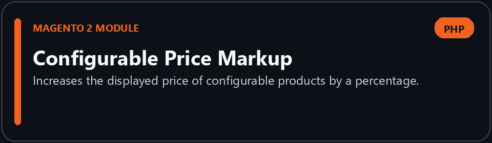
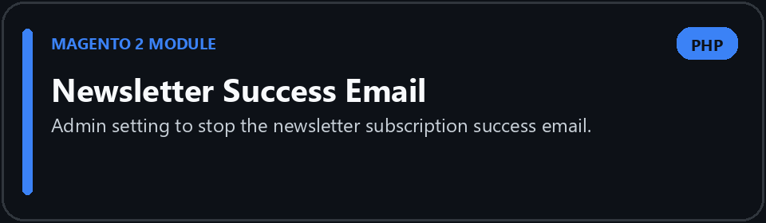
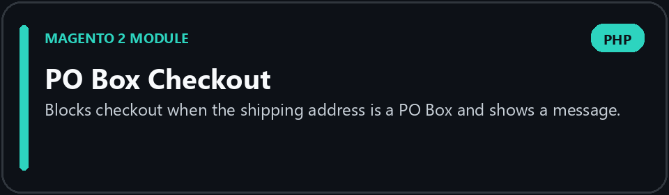
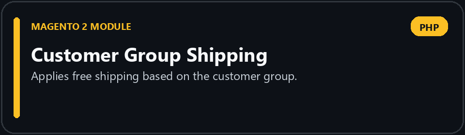
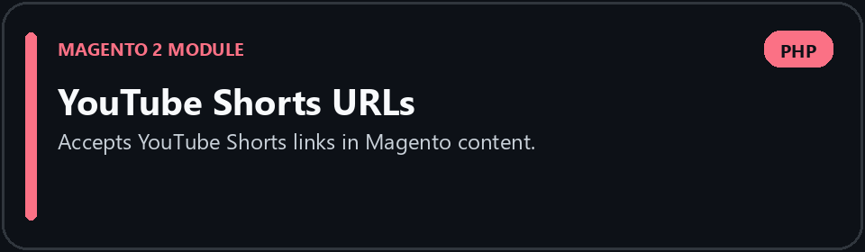
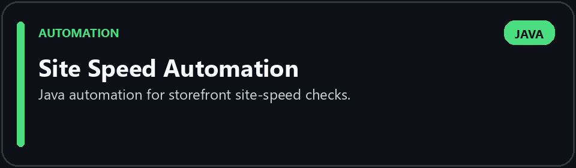
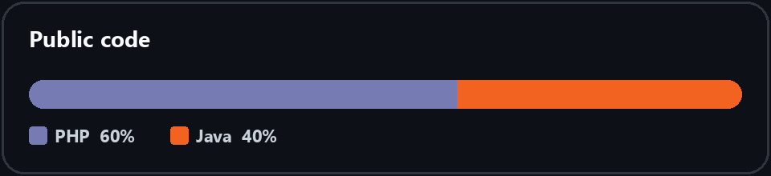

# Deepak Maheshwari

**Magento 2 Developer at Exinent LLC**

&nbsp;

&nbsp;

 

I build Magento 2 modules for live stores: checkout rules, catalog pricing, shipping, and admin settings. I also write Java automation for storefront checks and site speed.

### Stack

### Selected work

)

### Languages

 

